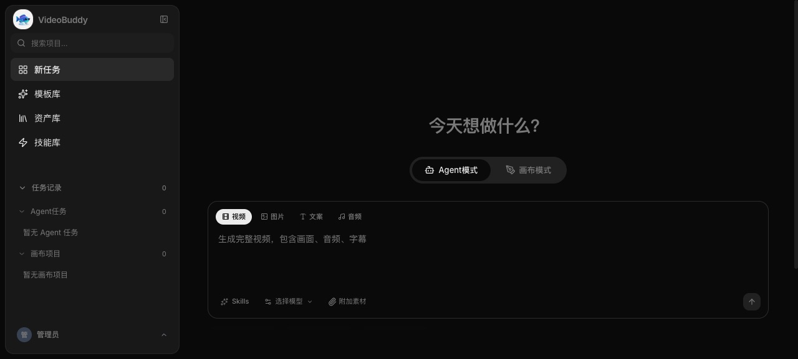
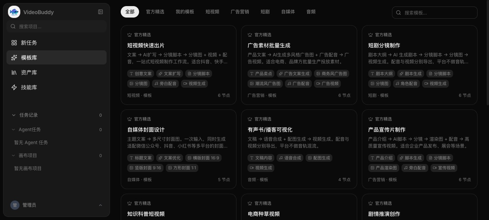
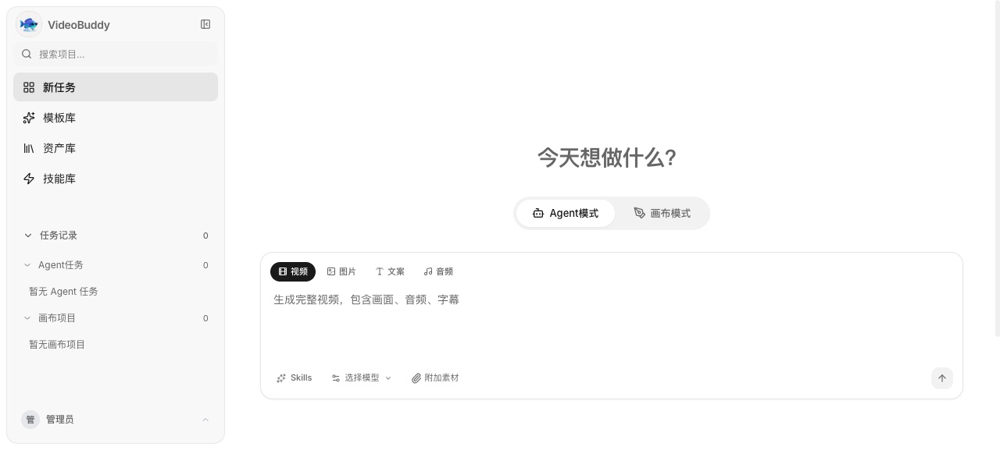

<!-- origin: 094CY/VideoBuddy -->
# VideoBuddy

基于节点画布的 AI 视频制作工作台。把文案、分镜、图像、视频、配音编排成流水线，配置模型服务后按拓扑顺序执行，产出素材文件。

## 功能

- 无限画布与节点式编排：拖拽、连线校验、撤销重做、快捷键、多种添加节点方式
- 六类节点覆盖文本、图片、视频、音频、脚本与 AI 处理，上下游结果自动传递
- 工作流按拓扑顺序执行，支持环检测、失败阻断、取消、重试与错误分级提示
- 模型服务支持接入预设：选定服务商后自动填入协议与地址，只需填 API Key 与模型 ID
- 管理员可发布团队共享服务：配置保存在服务端，密钥由服务端注入请求，不下发到浏览器
- 本地模型框架（Ollama / LM Studio / MLX / mflux）自动探测，与云端服务在「设置 → 模型 & Key」统一管理
- 服务端连通性测试可真实发起一次最小请求，确认配置能否调用模型
- 模板库、技能库、素材库、产物库、版本历史、批注与批量导出
- 服务端多租户：管理员创建成员账号，项目、素材、模板与产物按账号隔离；存储支持文件与 SQLite
- 明暗双主题与简体中文 / English 界面切换
- 会话管理、团队共享模型服务、审计日志与每日自动备份
- 首次使用引导、同步状态提示与未完成任务结果查询
- 工作区按租户保存在服务端，支持 JSON 备份导出与导入

## 技术栈

| 层级 | 技术 |
|---|---|
| 前端 | React 19、TypeScript、Vite、Tailwind CSS、shadcn/ui |
| 画布 | React Flow（`@xyflow/react`） |
| 状态 | Zustand；工作区数据浏览器缓存并同步到服务端 |
| 图标 | Lucide React |
| 后端 | Express（`server.js`）：AI 请求转发、会话鉴权、租户数据存储 |

## 目录结构

```
app/
├── src/
│   ├── components/          # 界面组件（ui、nodes、panels、workspace、layout、shared）
│   ├── config/              # 接口协议定义
│   ├── pages/               # 页面
│   ├── stores/              # Zustand 状态
│   ├── services/            # AI 调用层
│   ├── types/               # 类型定义
│   └── lib/                 # 工具函数
├── docs/                    # 产品文档
├── public/                  # 静态资源
├── scripts/                 # 构建与回归脚本
├── server/                  # 存储层与多租户数据
├── server.js                # 生产服务与 API 代理
└── vite.config.ts
```

## 快速开始

### 安装与开发

```bash
npm ci
npm run dev
```

同时启动前端（默认 5173）与后端（默认 3721）。开发模式下 `/api/*` 由 Vite 转发，前后端同源。

### 构建与生产运行

```bash
npm run build
npm start
```

访问 `http://localhost:3721`。生产服务同时托管 `dist/` 静态文件与 API 代理。

### 其他命令

```bash
npm run dev:frontend   # 仅前端
npm run dev:server     # 仅后端
npm run lint           # 代码检查
npm run preview        # Vite 预览构建产物
```

## 配置模型与密钥

生成类节点需要先接入模型服务。绝大多数服务商提供 OpenAI 兼容端点（对话 `/chat/completions`、生图 `/images/generations`），部分另提供 Anthropic Messages 端点；视频多为异步任务（提交后按任务 ID 轮询）。平台按这些公开协议构造请求；密钥由用户填写，模型 ID 按服务商文档确认。

### 团队共享服务（推荐）

「设置 → 模型 & Key → 团队共享」Tab 由管理员配置一次，配置与密钥保存在服务端，所有成员直接调用：

1. 选择接入预设（自动填好协议、API 根路径与鉴权方式）
2. 填 API Key 与模型 ID（预设给出常用示例，可修改）
3. 保存到服务端，点击「测试连接」真实发起一次最小请求验证

浏览器只拿到脱敏后的服务与模型列表；AI 请求经服务端代理时由服务端注入鉴权头。可用的接入预设与端点定义见 `src/config/model-catalog.ts`，每项附官方文档链接。

### 本机自建服务

「个人云端」Tab 的「添加服务」可以先选预设，再按需修改服务名、协议、地址与密钥。自建服务的密钥保存在当前浏览器，仅该账号可用；多人协作请改用团队共享服务。

服务地址填写「API 根路径」（例如 `https://<host>/v1`），平台自动拼接具体端点。保存时会把域名登记到当前账号的代理白名单。

## 部署

### 本地 / 自托管

```bash
npm ci
npm run build
npm start
```

服务默认监听 `127.0.0.1`。对外访问通过反向代理提供，并启用 HTTPS。

## 环境变量

复制 `.env.example` 为 `.env` 后按需修改。全部留空也能本地启动。

| 变量 | 默认值 | 说明 |
|---|---|---|
| `HOST` | `127.0.0.1` | 监听地址；反向代理后由代理对外提供访问 |
| `PORT` | `3721` | 服务端口 |
| `PROXY_ALLOWED_HOSTS` | 空 | 运维额外放行的域名，逗号分隔。用户在界面添加服务时自动登记该地址 |
| `CORS_ALLOW_ORIGIN` | 空 | 允许的跨域来源，逗号分隔，精确匹配；留空为同源 |
| `PROXY_TIMEOUT_MS` | `120000` | 代理请求超时（毫秒） |
| `MAX_RESPONSE_BYTES` | `33554432` | 上游响应体上限（字节） |
| `VB_DATA_DIR` | `./data` | file 后端的数据目录 |
| `VB_STORAGE_BACKEND` | `file` | 存储后端：`file` 或 `sqlite` |
| `DATABASE_URL` | 空 | SQLite 库文件路径；`sqlite` 后端使用 |
| `VB_ADMIN_ACCOUNT` | `admin` | 首次启动创建的管理员账号，支持邮箱、手机号、名称等字符串 |
| `VB_ADMIN_PASSWORD` | 空 | 首次启动管理员口令；生产环境必填，未设置时服务拒绝启动 |
| `VB_SECURE_COOKIE` | `0` | HTTPS 部署设为 `1`，会话 Cookie 带 Secure 标记 |
| `VB_BACKUP_INTERVAL_HOURS` | `24` | 自动备份间隔（小时），`0` 关闭；保留最近 7 份 |
| `VB_PROXY_QUOTA_PER_MIN` | `120` | 单账号每分钟 AI 代理请求上限 |

AI 密钥在应用内「设置 → 模型 & Key」填写。

## 约束与边界

| 项 | 说明 |
|---|---|
| 离线编辑 | 服务端不可达时改动写入浏览器缓存，恢复连接后同步；期间其他设备看不到这部分改动 |
| 密钥存放 | 团队共享服务的密钥保存在服务端；本机自建服务的密钥以 Base64 存于浏览器缓存，导出的备份可能包含它 |
| 上传素材 | 保存在服务端按账号划分的目录；服务端不可达时退回临时本地地址 |
| 视频成片 | 片段汇总与导出提供源文件批量下载；合成、转码与音轨混流由本地剪辑工具完成 |
| 方案类节点 | 配乐、音效、分镜网格等子类型产出文字方案 |
| 账号 | 管理员创建成员、重置口令、导出归档后删除账号 |
| 团队数据 | 记录成员与角色，各账号数据独立 |
| 本地模型 | 通过开发模式的 Vite 代理接入 |
| 并发 | `file` 后端为单进程，启动时对数据目录加实例锁；`sqlite` 后端由数据库事务保证并发安全，可多进程共享 |
| 关系型数据库 | 当前提供文件与 SQLite 两种后端；Postgres 需要异步适配器，配置后会明确拒绝启动 |
| 界面语言 | 主要导航、设置与高频操作支持中英文切换；专业术语与业务文案以中文为主 |
| 费用 | 用量页只记录真实调用次数与 Token 数，费用以服务商账单为准 |

安全与隐私细节见 `docs/隐私与安全说明.md`。

## 文档

- `docs/隐私与安全说明.md` — 数据存放、密钥边界与代理防护

## 协议

采用 [VideoBuddy 非商业研究与学习许可](./LICENSE)：允许学习、研究与非商业技术交流，不允许任何商业性使用。商业使用须另行取得版权人 094CY 的书面授权。

---

## 开源与社区

- 许可证：[VideoBuddy 非商业研究与学习许可](./LICENSE)（源码可见，禁止商业使用）
- 第三方接口与隐私说明：[NOTICE.md](./NOTICE.md)
- 安全漏洞反馈：[SECURITY.md](./SECURITY.md)
- 参与贡献：[CONTRIBUTING.md](./CONTRIBUTING.md)

本地开发默认凭据仅在开发模式生效；生产部署必须设置 `VB_ADMIN_PASSWORD`，未设置时服务拒绝启动。

## 界面预览

| 新建任务（深色） | 模板库 | 新建任务（浅色） |
| --- | --- | --- |
|  |  |  |

界面截图为演示状态，取自当前版本，明暗两种主题均实测无白屏与控制台错误。
内置模板与技能为产品自带内容；截图不含真实用户数据、账号、口令或密钥。
